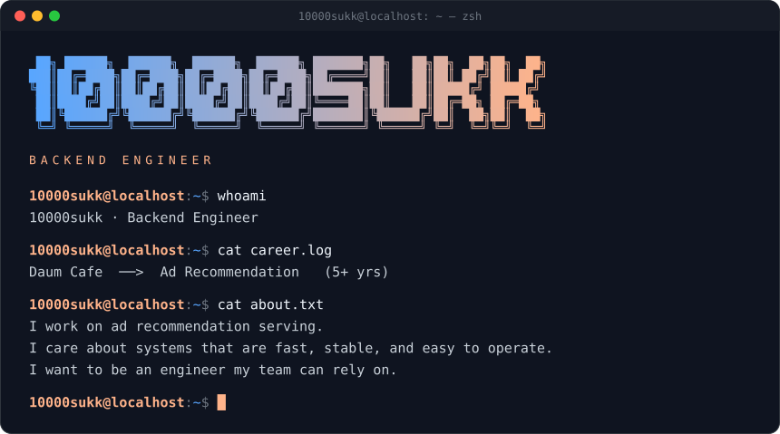
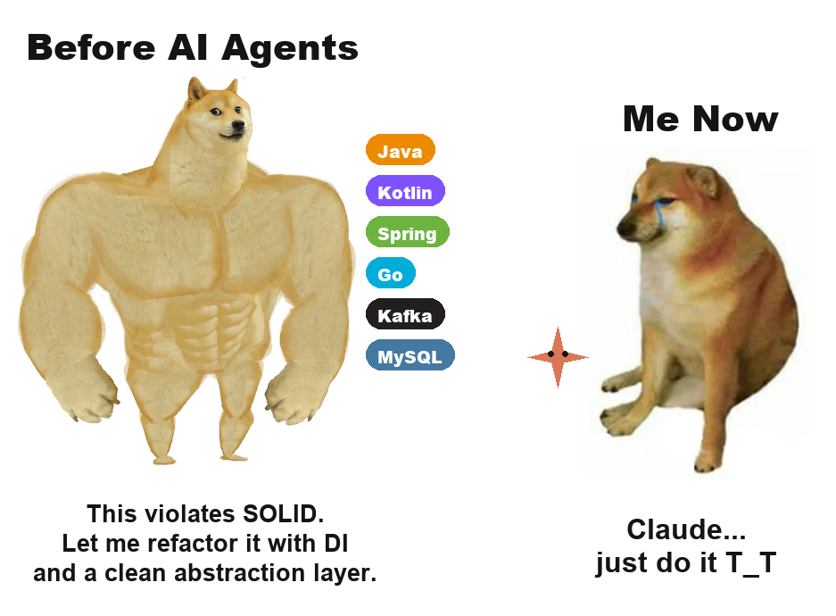

---

## 🧑‍💻 About Me

- 🏢 **Kakao** — 5+ years as a backend engineer. Daum Cafe → Ad Recommendation.
- 🎓 **University of Seoul**, Computer Science (B.S.)
- 🛠 **Backend specialist**: Java/Kotlin, Spring Boot, Go
- 📊 **Data platforms**: MySQL, MongoDB, Redis, ClickHouse, Druid

## 🛠 ~~Tech Stack~~

| Category | Tech |
|---|---|
| ~~**Language**~~ | ~~Java~~ · ~~Kotlin~~ · ~~Go~~ · ~~Python~~ |
| ~~**Framework**~~ | ~~Spring Boot~~ · ~~Spring Batch~~ |
| ~~**Database**~~ | ~~MySQL~~ · ~~MongoDB~~ · ~~Redis~~ · ~~ClickHouse~~ · ~~Apache Druid~~ |
| ~~**Infra**~~ | ~~Docker~~ · ~~Kubernetes~~ · ~~GitHub Actions~~ |
| ~~**Data / ML**~~ | ~~Apache Airflow~~ · ~~Jupyter~~ |

## 👋 Good Bye, My Tech Stack

 

These days I build everything with **Claude Code** & **Codex**.

---

**Always learning, always building.**

